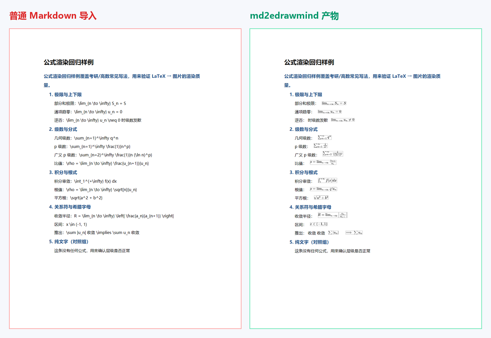

<div align="center">

# md2edrawmind

**把 AI 生成的「满屏 `$LaTeX$` 公式」的 Markdown 笔记，转成思维导图软件能正常导入的 Word —— 公式一条都不丢。**

[English](README.md) · 中文

[](https://github.com/socoolgzh-max/md2edrawmind/actions/workflows/ci.yml)
[](LICENSE)
[](pyproject.toml)
[](package.json)
[](#已知限制)
[](#功能)

[下载](#下载) · [快速开始](#快速开始) · [功能](#功能) · [原理](#原理) · [文档](#文档) · [路线图](#路线图)



</div>

> **十秒版。** 你让 AI 生成一份复习导图，它给你一段满是公式的 Markdown。你一导入——公式变成了 `\lim_{n \to \infty} S_n = S` 这串原文，或者被拍平成 `limn→∞Sn=S`，甚至整份笔记被换成了另一种字形。
>
> 这个工具把它转成 `.docx`：**每条公式都是清晰渲染的图片**，**标题层级在导入后依然成立**。你看到的导图，才是你要的导图。

---

## 下载

**Windows 10 / 11，免安装。** 下载桌面版，解压后双击 `md2edrawmind.exe`，界面会自动在浏览器里打开。

[-b4531f?style=for-the-badge&logo=windows&logoColor=white)](https://github.com/socoolgzh-max/md2edrawmind/releases/latest)

桌面版自带 Python 与 Node 运行时，什么都不用装；公式渲染用你机器上已有的 Chrome 或 Edge。习惯命令行的话看[快速开始](#快速开始)。

---

## 为什么需要它

思维导图软件是把 Markdown 当**纯文本**解析的，它根本不知道 `$...$` 是什么。

下面这些结论都是实测出来的（完整记录见 [docs/FINDINGS.md](docs/FINDINGS.md)）：

| 导入方式 | 结果 |
| --- | --- |
| 导入 Markdown | ✗ 公式原样变成文字 |
| 导入 HTML（走「智能解析」） | ✗ 走云端 AI：**简体被悄悄转成繁体**、层级塌掉、公式变成标签 |
| Word 原生公式（OMML） | ✗ Word 导入器不认 OMML，会把公式**拍平成字符**：`limn→∞Sn=S` |
| 公式用 SVG 矢量图 | ✗ 导入器拒绝 SVG |
| **公式渲染成 PNG → 本地导入 Word** | ✓ 公式保留、层级正确、文字不被改写 |

还有一个坑：**公式夹在主题文字中间时，会被当成「批注」**。所以本工具默认把公式**挪到主题末尾**——这是实测能正常显示的形态。

## 功能

| | |
| --- | --- |
| **公式不丢** | MathJax v3 把每个 `$...$` 渲染成适合导入的图片，分式、求和、积分、极限全部完整 |
| **层级不塌** | 写入 `w:outlineLvl`（大纲导入真正读取的标记），而不是只靠缩进 |
| **本地图形界面** | `python -m md2edrawmind serve` → 拖入 `.md` → 看进度 → 下载 `.docx` |
| **命令行** | `convert` / `serve` / `check` / `install-tools`，可脚本化、可进 CI |
| **全程离线** | 不上传、不登录、不走云端 AI：笔记不离开这台机器 |
| **无水印** | 导出的公式图片不带水印（细节见[已知限制](#已知限制)） |
| **自动切分** | 免费版导入上限 50 个主题，`--limit 46` 会自动切分 |
| **三种排版** | `tail`（公式在末尾）/ `own`（公式单独成条）/ `keep`（保持原句） |

## 快速开始

```bash
git clone https://github.com/socoolgzh-max/md2edrawmind && cd md2edrawmind
pip install -r requirements.txt && npm install     # python-docx、Pillow、mathjax-full、pngjs
python -m md2edrawmind check                       # 自检 Python / Node / 浏览器
```

然后二选一：

```bash
python -m md2edrawmind serve                       # 图形界面 http://127.0.0.1:8787
# 或
python -m md2edrawmind convert 笔记.md              # → 笔记.docx
```

最后：**EdrawMind → 导入 → Word → 选那个 `.docx`**。

界面只有一列：一个拖拽区、一条细线下的三项设置、一行结果。没有账号、不上传、不走云端，375px 宽也能正常用。

<details>
<summary><b>看看工作流程（动图）</b></summary>


</details>

<details>
<summary><b>改用 PyPI 安装</b></summary>

```bash
pip install md2edrawmind
md2edrawmind install-tools        # 拉取 JS 公式渲染器（mathjax-full、pngjs）
md2edrawmind check
```

</details>

<details>
<summary><b>全部命令行参数</b></summary>

| 参数 | 说明 |
| --- | --- |
| `--mix tail` | **默认**。文字在前，公式挪到主题末尾（最稳） |
| `--mix own` | 每条公式单独成为一条子主题 |
| `--mix keep` | 保持原句顺序（公式夹在中间会变批注） |
| `--limit N` | 每个文件最多 N 个主题，超出自动切分（免费版上限 50） |
| `--outline` | 同时导出制表符缩进的纯文本大纲（备用导入方式） |
| `--work DIR` | 指定中间文件目录（公式表、公式图片） |

</details>

## 原理

```
笔记.md
  │
  ├─ parser.py        标题/列表 → 主题树；拆分文字与公式；应用排版策略
  │
  ├─ tools/render.js  MathJax v3 → SVG（字形转路径，不依赖字体）
  │                   → 把所有公式排到一张精确测量过的"公式表"上
  │
  ├─ Chrome 无头截图   一次截图渲染全部公式
  │
  ├─ tools/render.js  按坐标切成一张张去白边的 PNG
  │
  └─ docx_writer.py   写入 w:outlineLvl 层级 + 内嵌公式图片 → .docx
```

不需要装 LaTeX、不需要 pandoc、不需要 Office —— 只要 Node 和一个浏览器。

## 文档

| 文档 | 内容 |
| --- | --- |
| [docs/FINDINGS.md](docs/FINDINGS.md) | **逆向记录**：哪些导入方式走本地、哪些走云端；OMML 为何被拍平；`w:outlineLvl` 的作用；`.emmx` 内部结构 |
| [docs/FAQ.md](docs/FAQ.md) | 「公式变成批注」「50 主题上限」「水印」「转换失败排查」 |
| [CONTRIBUTING.md](CONTRIBUTING.md) | 怎么跑测试；怎么新增对另一个软件的支持（附证据清单） |
| [CHANGELOG.md](CHANGELOG.md) | 版本记录 |

## 已知限制

> [!IMPORTANT]
> 公式在导图里是**图片**：显示完美，但不能像公式对象那样二次编辑 —— 因为目标软件的 Word 导入不支持 OMML。这是软件的限制，本工具选择把它写清楚，而不是藏着。

- 针对 **EdrawMind 12.2.2（Windows）** 实测与验证；换其他软件需要另做格式适配（欢迎[提 issue](https://github.com/socoolgzh-max/md2edrawmind/issues)）。
- 公式图片在 PNG/JPG 导出**无水印**，但 **PDF 导出仍带软件试用水印**（软件策略，转换器绕不过去）。
- 多行公式环境（`aligned`、`cases`）目前按单行渲染。
- 渲染需要 Chrome 或 Edge；截图画布固定 14000px 高，超长笔记请用 `--limit` 切分。

## 路线图

- [x] 图形界面 + 命令行 + PyPI 打包
- [x] `docs/FINDINGS.md` 逆向记录
- [x] `examples/` 里的 113 条公式压力样例
- [ ] 适配第二个目标软件（XMind / FreeMind），**先实测**其导入行为
- [ ] 多行公式环境（`aligned`、`cases`）
- [ ] macOS / Linux 的路径探测与打包

## 参与贡献

```bash
python tests/test_parser.py         # 解析器 + docx 单元测试（不需要浏览器）
python tests/smoke_gui.py 8899      # GUI 闭环：上传 → 进度 → 下载 → 校验 docx
python -m md2edrawmind convert examples/考研数学-无穷级数.md -o build/check.docx
```

Fork → 新建分支 → 提 PR。如果要支持另一个软件，请**先实测它的导入行为**，并把证据写进
`docs/FINDINGS.md` —— 详见 [CONTRIBUTING.md](CONTRIBUTING.md)。

## 许可证

[MIT](LICENSE) —— 随便用。
